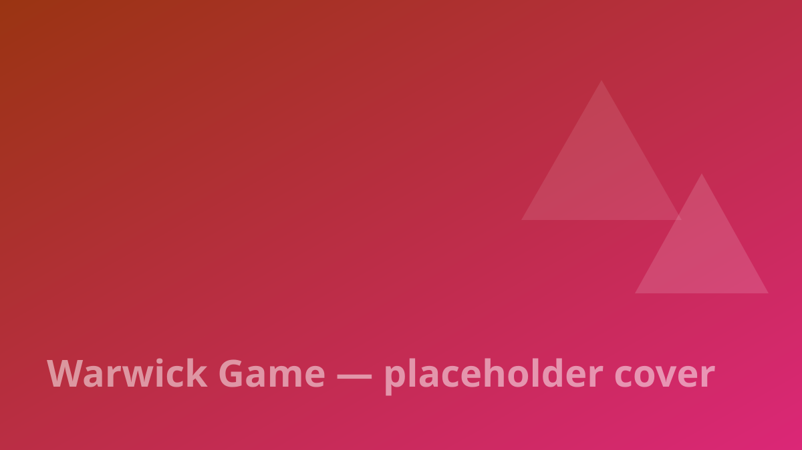

## Overview

Games built during the Games Engineering master's at Warwick — individual and group projects using our **own engine**, **Unreal Engine** and **Godot**.

## Highlights

- A game running on the engine we built from scratch
- Group projects exploring different engines and genres

> Replace this text with the real write-up — and drop gameplay videos here as ``, they render as playable videos.
