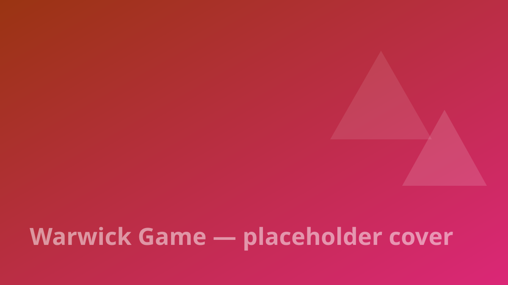

## Visão geral

Jogos construídos durante o mestrado em Engenharia de Jogos em Warwick — projetos individuais e em grupo usando nossa **própria engine**, **Unreal Engine** e **Godot**.

## Destaques

- Um jogo rodando na engine que construímos do zero
- Projetos em grupo explorando diferentes engines e gêneros

> Substitua este texto pelo texto real — e coloque vídeos de gameplay aqui como ``, eles viram players de vídeo.
